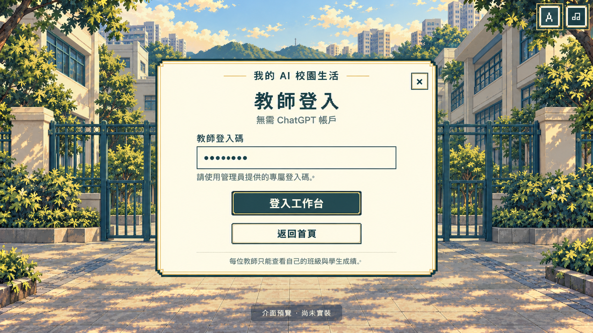

# Recent visible messages — English supplement

Prepared on 11 October 2026; appended on 12 October 2026. This is a **partial supplement**, not an extension of the timestamp-verified transcript in [conversation-en.md](conversation-en.md). It translates **19 user messages and two actual assistant progress messages** available from the active project conversation, in their recorded relative order. The latest Mandarin and phone-map reports and both assistant messages were supplied verbatim for this update. Exact timestamps and other intervening assistant replies were unavailable, so they are not reconstructed. No reusable transcript exporter was found in the project, and no broad session-log search was performed.

User-provided reference screenshots are described but not republished. New generated-image events have not been inserted into the historical manifest without their original completion records. Environment/context blocks, tool question payloads, development instructions and internal agent coordination are excluded. The API-key confirmation records only that a file was saved; no key value was read or included.

---

User:

On the mobile layout, the character image is too large. Some text, such as “Skip,” is also too large.

[A user-uploaded mobile dialogue screenshot accompanied this request.]

---

User:

1. NPCs move too frequently, which makes adding more NPCs feel meaningless. I want every NPC to have a specific behavior, such as reading in a particular place or talking with another NPC. All students and teachers should follow sensible behavior patterns instead of simply walking around.
2. Please ensure the game meets the standards of art direction and character/story supervision.
3. Add your own careful AI review and observation to judge whether the game is suitable for users and designed around their needs.
4. Carefully check the website for errors, how it should be published and uploaded to GitHub, and how users can learn to open it through the GitHub README. Would it be most convenient to provide a Windows or Mac application, or a ZIP that people can download and play?

---

User:

You can add those everyday campus behaviors, but make sure each pixel character has its own action animation and that activities last for a sensible amount of time. Preferably, all student NPCs who cannot be approached for dialogue should have no facial features, so they are distinct from the main character. Add more student NPCs to make the campus feel lively.

---

User:

On the desktop version, the campus background has disappeared from character selection, and the character preview is clipped. Please fix this.

[A user-uploaded desktop character-selection screenshot accompanied this request.]

---

User:

[OpenRouter TTS documentation](https://openrouter.ai/docs/guides/overview/multimodal/tts). I can provide my OpenRouter API key; please help me generate speech through a website interface.

---

User:

Continue all correction tasks, and review the [OpenRouter TTS documentation](https://openrouter.ai/docs/guides/overview/multimodal/tts). I can provide my OpenRouter API key; please help me generate speech through a website interface.

---

User:

Isn't there a free API key available to use?

---

User:

If there are not enough different voices, they can be reused. But Traditional Chinese must use Cantonese, Simplified Chinese must use Mandarin, and English must use English.

---

User:

Confirmed: add it to the teacher workspace.

[The user's selected response approving the Speech Studio direction. The interface question payload is not reproduced.]

---

User:

How should I enter the API key in the game?

---

User:

I cannot find the configuration file.

[The user's selected response to the local configuration-file setup prompt.]

---

User:

I have saved the API key in `.env.openrouter.local`.

[No API key value was included in this visible message or this archive.]

---

User:

The Cantonese generation is incorrect. What I hear is Mandarin.

---

User:

Use the Cantonese read-aloud I already had.

---

User:

I have been thinking: I have already confirmed that the Mandarin and English voices are usable, so a Speech Studio is not really necessary. You can simply check and verify them behind the scenes, then apply them in my game. None of the academic questions needs speech. This means the audio will not need continuous updates whenever teachers change the questions.

---

User:

The Mandarin speech in Simplified Chinese has disappeared again. Please thoroughly fix and improve this issue.

---

ChatGPT:

I have reproduced one clear cause: the Mandarin female voice “Tingting” on your computer can play a complete utterance, but there is no Mandarin voice that the game can identify as male. The gender check therefore blocks male characters and leaves them silent. There is also a delayed voice-list loading issue, which I will fix. I am testing whether free fixed audio files with an explicitly identified male Mandarin voice can fill the gap, so character speech will no longer depend entirely on which voices players have installed on their computers.

---

ChatGPT:

The cause of missing Mandarin speech has been identified: some characters have no device voice matching their gender, and there was no retry when the voice list loaded slowly. I am adding fixed Mandarin and English dialogue files to the game and correcting the loading wait. Academic questions will remain silent, and Traditional Chinese will retain the existing Cantonese speech.

---

User:

The mobile map layout needs to be corrected.

[The user supplied a reference screenshot named “螢幕截圖 2026-10-11 下午7.38.12”; the screenshot is not republished in this text supplement.]

---

## 12 October 2026 supplement

The following two user requests were supplied directly in the active conversation. This date records the supplement; exact message times are not asserted. No missing assistant response has been reconstructed.

User:

Can the game let teachers add more questions, perhaps more than three, and decide how many stars each question awards? When printing results, the report should also show how many stars each student has earned.

---

User:

After completing that improvement, upload it again and update the public webpage linked from GitHub, so anyone can play by opening the link or scanning the QR code without logging in. Also organize the files already uploaded to GitHub into folders such as game, resources, audio, images and data.

---

## 13 October 2026 hosting supplement

The following user messages and selected answers were supplied directly in the active conversation. This date records the supplement, not exact message times. Missing assistant replies are not reconstructed. Private credentials and internal permission details are not included.

User:

I did not see any updates on GitHub.

---

User:

https://github.com/Jackcrabb/my-ai-campus-life

---

User:

Not every user can use ChatGPT, including users in regions with restrictions, such as Hong Kong. Please make sure Hong Kong users can open and play my website at any time without logging into ChatGPT, including opening the teacher permissions.

---

User:

I do not have an account. Set up a free account.

[The user's selected response to the Cloudflare account question.]

---

User:

Completed.

[The user's selected response after registering and verifying the Cloudflare account.]

---

User:

Confirmed. Implement it this way.

[The user's approval of the pixel-style teacher access-code login preview. The original generated preview is preserved below; the following user message requests removal of its platform-account subtitle. This new artifact is separate from the earlier 98-image archive count.]

Generated image: approved teacher login preview

[Provenance and implemented screenshots](../resources/design/qa-independent/README.md)

---

User:

You can remove the wording “No ChatGPT required.”

---

User:

I authorize these permissions. Please continue.

[The user's explicit authorization of the official Wrangler access request for User Read, Account Read, Workers Scripts Write, D1 Write and Background Access. No token, code or credential value is included.]

Editorial evidence note: the later implemented [desktop login](../resources/design/qa-independent/teacher-login-desktop.jpg), [mobile login](../resources/design/qa-independent/teacher-login-mobile.jpg) [teacher subject chooser](../resources/design/qa-independent/teacher-workspace-desktop.jpg) and [desktop student setup](../resources/design/qa-independent/student-setup-desktop.jpg) are linked for comparison. These are browser captures, not reconstructed ChatGPT messages or additional image-generation events. Their [metadata record](../resources/design/qa-independent/assets.json) keeps them separate from the original generated preview.
