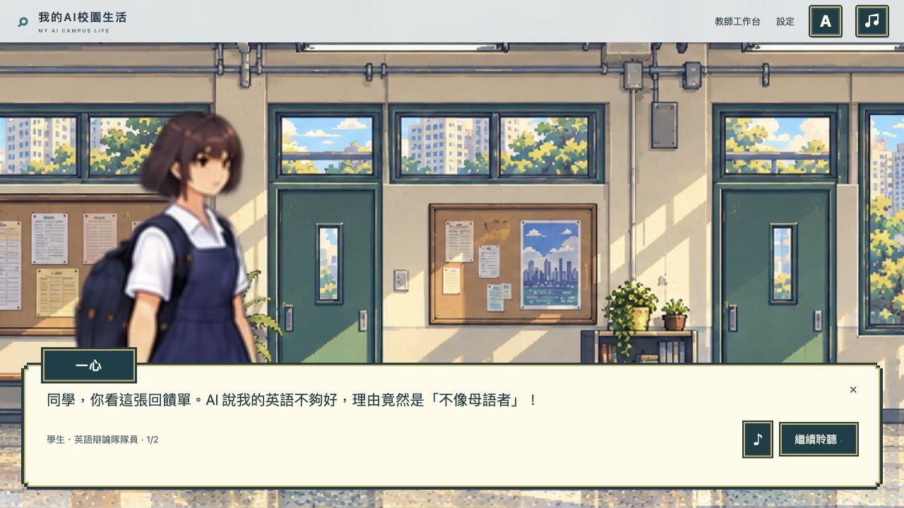

# My AI Campus Life

**我的 AI 校園生活** — a pixel-art school adventure about **ethical and inclusive AI practices**, designed for Hong Kong secondary students and an HKU MEd MEDD8934 group assignment.

[繁體中文](README.zh-Hant.md) · [User guide](USER-GUIDE.md) · [Design and teaching guide](DESIGN-AND-TEACHING-GUIDE.md) · [Asset provenance](ASSET-PROVENANCE.md) · [Known limitations](KNOWN-LIMITATIONS.md) · [English conversation archive](Chat%20Recording/README.md)



*Actual browser capture of the implemented interface. [More verification screenshots](design/design-qa.md).*

Join the fictional **Ming Ching College** as an ordinary new student. Choose your year, class and appearance, explore five floors, meet classmates and staff, and practise making thoughtful decisions about AI. The learning loop is simple: **listen → examine evidence → decide → repair → reflect**.

**Public game:** [Open My AI Campus Life](https://lumen-lab-ai-ethics.tart-vale-4903.chatgpt.site). The existing public entry was verified on 10 October 2026 (Hong Kong time); sharing links and a printable QR code are below. This README describes the current repository version. The deployed revision and its verification scope are recorded separately with each release.

## What is included

- **Five floors, 18 locations and 13 learning spaces**, covering languages, mathematics, science, humanities, arts, computing, PE and interdisciplinary activities.
- **234 starter questions**: six grades × 13 spaces × three questions. The default activity contains 39 questions for the selected grade. All 234 authored questions have been revised against Education Bureau/HKEAA references, with trilingual generation, structure/mathematics checks and cross-agent review. This is not a complete curriculum or official examination bank; see the [curriculum alignment](docs/CURRICULUM-ALIGNMENT.md).
- **Four AI scenarios** about accent assessment, writing privacy, cultural voice in translation, and inclusive participation, followed by transfer and reflection.
- **Three interface languages**: Traditional Chinese, Simplified Chinese and English. Language-learning examples may retain their target language.
- **48 appearance combinations** from two character categories, four outfits each, two hairstyles and three skin tones. These are combinations of eight source atlases, not 48 separately generated characters.
- **20 named NPCs** with independent identities, different natural heights/builds, detailed dialogue portraits and walking tied to actual distance. Student NPC clothing follows the selected uniform index while keeping their own gender, hairstyle and face. Names appear in dialogue only.
- **Classroom tools** for class codes, cross-device recovery, versioned questions, assignment history, teacher-uploaded PDF worksheets and teacher Excel results. Students open worksheets with **Print in the top-right HUD**, scoped to the current floor; there are no physical printer objects in the campus scenes.
- **A shared cream, deep-teal and gold pixel interface**, including door-mounted room signs, map, dialogue, questions and teacher panels.
- **Optional speech and music**, with independent volumes, replay and mute.

All in-game AI responses and consequences are authored teaching simulations. The game does not call a generative AI service. For MEDD8934, pair it with the actual-tool demonstration in the [teaching guide](DESIGN-AND-TEACHING-GUIDE.md); playing a simulation does not satisfy a live AI demonstration requirement by itself.

## Start playing

**New Game opens a Student / Teacher role chooser.** Choose **Student** to begin a new character setup, or **Teacher** to sign in and open the standalone teacher workspace without creating a student avatar or entering the campus. Opening the chooser or the teacher workspace preserves the student save; choosing a new Student starts the replacement student flow. There is no report/download confirmation. **Continue returns directly to the saved campus** and is disabled until a game has started. Student learning-report downloads have been removed; teacher Excel export and worksheet PDF printing/download remain. The **Settings button on the start menu is currently disabled**; settings are available from the in-game toolbar after starting.

The top-right controls appear in this order: **A** for language, then the **music-note button** for sound settings.

| Action | Control |
|---|---|
| Move | WASD or all four arrow keys |
| Talk to a nearby person | E |
| Enter a room or use a nearby entrance | Space or Enter |
| Approach and interact | Click a person, door or staircase |
| View the floor plan | In-game Map, highest level at the top and ground level at the bottom |
| Close a panel | Escape or its close control |

The Cases and Subjects panels are read-only star/completion records. They do not open questions; visit the corresponding NPC or room to answer. The five-level map runs from 4F (fifth level) down to G (first level).

NPCs walk slightly slower than the player (150 versus 170 world units per second), with acceleration, braking, rest pauses and distance-driven footsteps. Appearance selection, dialogue, questions and the journal use in-page panels. The teacher workspace uses the same interface and is also accessible directly from the title screen without starting the game. Text remains available when audio is muted or unavailable. See the [user guide](USER-GUIDE.md) for student and teacher workflows.

## Free exploration and class mode

**Free exploration** needs no sign-in and saves progress in the same browser. Its existing scores are not imported into class assessment.

**Class mode** uses a teacher-provided class code. A student joins with their number and name, then receives a private recovery code. The class code, student number and recovery code allow them to continue on another device without a ChatGPT account. Names and numbers are self-reported; this is not school SSO or independent identity verification.

Class records are stored in Cloudflare D1. Student APIs return only the current student's records, and teachers manage only classes they own. The server grades answers, preserves question versions and handles repeated submissions without duplicate rewards. A progress conflict prompts a reload instead of silently overwriting another device. Sign out after using a shared computer and keep recovery codes private.

### Stars and assessment

Stars reward the **first correct completion** of an activity; retrying cannot farm extra stars. Class subject scores retain **first responses**, so a later correct retry can earn progress stars without rewriting the original assessment. Incomplete subjects remain unscored rather than being reported as zero.

The default maximum is **103 stars**: 78 subject stars, 20 scenario stars and 5 transfer stars. The default exit threshold is 100. A custom assignment uses the lower of 100 and its available star total.

These are formative records, not moral ratings or a secure examination system. The public practice bank includes learning answers. Review students' evidence, explanations and repairs alongside numerical results.

## Teacher workspace

From the title screen, choose **New Game → Teacher**. After signing in and unlocking, choose one of **13 learning subjects or AI Ethics and Inclusion**. The subject hub opens question management, worksheets or results; **Change subject** returns to the chooser. Grade, class and activity filters are retained while switching tools. The in-game **Settings → Teacher workspace** entry also remains available. Production access requires a trusted **ChatGPT identity**, membership in the server's teacher allowlist, and the configured **teacher PIN**. The requested shared PIN is **1234**, supplied through `TEACHER_PIN`; it is not sufficient without the authorized identity. Incorrect PIN attempts are rate-limited, and an unlock lasts 30 minutes.

Teachers can create individual classes or explicitly create all 24 classes (S1–S6, sections A–D), copy class codes, author and archive subject questions, and start new class activities. Each activity freezes its question revisions, so subsequent edits do not change previous questions, scores or denominators. The **AI Ethics and Inclusion** hub provides read-only access to the four core AI scenarios and transfer task, plus their results. These core entries cannot be edited, and PDF uploads are provided for the 13 learning subjects.

The Results tab filters by class, subject and activity. **Download subject Excel** exports the selected subject. **Download all subjects** explicitly exports all 14 result categories in separate sheets. Both use these fixed headers:

| 班別 | 學號 | 學生姓名 | 學科得分 |
|---|---|---|---|

Class lists and results exports are available only through authorized teacher access. In the **Worksheets** tab, the selected subject is carried through from the hub; teachers choose a grade and upload a Traditional Chinese PDF, an English PDF, or both, up to **5 MiB per file**. Students see only authorized worksheets for their class grade and the current floor’s subjects. A chosen version opens a preview; **Print PDF** then requests the viewer/browser print flow. **Open PDF** and **Download PDF** are retained as fallbacks. Opening Print or loading a preview does not print automatically. See the [worksheet guide](docs/WORKSHEETS.md) and [user guide](USER-GUIDE.md).

## Sound

Dialogue is synthesized **at playback time by Web Speech**, rather than supplied as recorded actor files. The language mapping is strict:

- Traditional Chinese requires **Cantonese** (`zh-HK` or `yue`).
- Simplified Chinese requires **Mandarin** (`zh-CN` preferred; `zh-SG`/`zh-TW` alternatives).
- English requires **English** (`en-GB` preferred).

**The code now enforces both language and known character gender before choosing a voice**, including the `boy/girl` character aliases. If no matching voice exists, automatic speech stops with an unavailable status; it does not substitute an opposite-gender voice. English numerals are expanded into English words for speech only, with the displayed text unchanged and each sentence kept in one utterance. Speech uses the natural Web Speech defaults, rate `1` and pitch `1`; queued starts, language changes and replay have regression coverage. **Actual pronunciation and fluency still require listening checks on the target device.** The read-only native inventory audit on this Mac found no known male Cantonese or Mandarin voice, so male dialogue in those languages can remain silent. A browser may expose a different voice inventory; a distinct voice for every character is not promised.

The selected replacement workflow is **free, manually generated MP3 files: TTSFree first, with TTSMaker as a manual fallback**. Follow the [free voice production guide](docs/FREE-VOICE-TOOLS.md). This workflow does not require a Google Cloud project, billing setup, API key or self-hosted model. The earlier Cloud and self-hosting documents are retained as optional historical research. The current audition baseline is **TTSFree Default: raw rate `0`, pitch `0`**, chosen for natural, fluent speech; earlier `100/100` and `70/100` adjustment settings are superseded. These provider controls are not Web Speech rate equivalents. Three Default auditions have been downloaded: Cantonese HiuMaan, Mainland Mandarin Xiaoyi and British English Sonia, each about 9–10 seconds. The Taiwan Mandarin YunJhe attempt failed twice with zero-byte output and is not a usable sample. The three files still require listening approval; they do not constitute a completed character voice library. **No prerecorded MP3 dialogue is integrated into the game yet; the current runtime uses the corrected Web Speech selection and text preparation described above.**

The auditions were generated in the free Guest interface with fictional text, without an account, API key or payment. [Cantonese HiuMaan — about 10.0 s](design/voice-auditions-free/zh-hk-hiumaan-default.mp3) · [Mandarin Xiaoyi — about 9.3 s](design/voice-auditions-free/zh-cn-xiaoyi-default.mp3) · [English Sonia — about 9.6 s](design/voice-auditions-free/en-gb-sonia-default.mp3). [Audition text, settings and verification record](design/voice-auditions-free/README.md).

**Teacher-created or edited questions may have no matching recording, or only an older one. The latest written question, options and feedback are authoritative.** Each changed version needs manual MP3 regeneration, listening review and integration before its audio can be used; saving or publishing a question does not automatically update recordings. A future audio integration must retain readable text and avoid playing a clip for a different question revision. TTSFree currently lists only three Cantonese voices, so twenty characters cannot be promised twenty unique Cantonese voices; keep each character's chosen voice consistent within each language.

Background *Greensleeves* is newly synthesized with an original Web Audio arrangement based on the [Mutopia public-domain score](https://www.mutopiaproject.org/ftp/Traditional/greensleeves/greensleeves-let.pdf). No DSE or commercial performance recording is used. Audio needs a user gesture, music lowers during dialogue, and playback pauses when the page is hidden. See [asset provenance](ASSET-PROVENANCE.md) for the score, API references and production records.

## Local development

The application uses **Sites / Vinext, a vanilla JavaScript canvas frontend, Cloudflare D1 and R2 worksheet storage**. Use **Node.js 22.13 or newer** and npm.

```sh
npm run install:ci
npm run dev
```

Open the URL printed by the development command. The application entry redirects to `/campus/index.html`. A static file server cannot provide the class API, trusted teacher identity or D1 persistence.

### Environment and database

The D1 binding is **`DB`** and the R2 worksheet binding is **`BUCKET`**, configured in `.openai/hosting.json`. Production must configure `TEACHER_EMAILS` and `TEACHER_PIN` through the deployment environment; an empty owner allowlist grants no teacher access. Do not commit personal owner addresses, credentials, runtime class/recovery codes or student exports.

An ignored `.dev.vars` file can enable the existing `CAMPUS_LOCAL_TEACHER` development flag for local teacher testing. That exception requires non-production execution and a loopback host; it is not a production sign-in route. Use the real authorized identity flow to verify a production build.

The schema lives in `db/schema.ts`; generated migrations live in `drizzle/`. After changing the schema, run `npm run db:generate` and review the migration. For a **new, empty local database**, generate the Worker configuration and apply all three existing migrations once, in order:

```sh
npm run build
node --import ./scripts/sites-env.mjs ./node_modules/wrangler/bin/wrangler.js d1 execute DB --local --config dist/server/wrangler.json --persist-to .wrangler/state --file drizzle/0000_yummy_fat_cobra.sql
node --import ./scripts/sites-env.mjs ./node_modules/wrangler/bin/wrangler.js d1 execute DB --local --config dist/server/wrangler.json --persist-to .wrangler/state --file drizzle/0001_plain_omega_sentinel.sql
node --import ./scripts/sites-env.mjs ./node_modules/wrangler/bin/wrangler.js d1 execute DB --local --config dist/server/wrangler.json --persist-to .wrangler/state --file drizzle/0002_lazy_catseye.sql
npm run start
```

For an existing database, apply only migrations that have not already been applied. The backend test suite uses isolated Miniflare D1/R2 instances and does not require resetting preview data.

### Project map

| Path | Responsibility |
|---|---|
| `app/page.tsx`, `app/api/campus/[...path]/route.ts` | Application entry, same-origin API and platform identity |
| `lib/campus-*.ts`, `db/schema.ts`, `drizzle/` | Authorization, records, versioned assignments, scoring and persistence |
| `data/grade-bank.json`, `scripts/content-authoring/` | Curated question data and authoring sources |
| `public/campus/app.js`, `campus-cloud.js` | Game state and cloud integration |
| `public/campus/engine.js`, `characters.js`, `campus-art.js` | Exploration, character identity, animation and scenes |
| `public/campus/teacher-ui.js`, `xlsx-export.js` | Teacher subject hub, workspace and Excel export |
| `public/campus/worksheet-ui.js`, `lib/campus-worksheets.ts` | PDF upload, authorized access, preview and explicit printing |
| `public/campus/campus-audio.js` | Speech synthesis and music |
| `public/campus/assets/`, `design/production-life/` | Runtime art and production provenance |

### Verification

```sh
node tests/backend.test.mjs
node tests/starter-update.test.mjs
node tests/worksheet-backend.test.mjs
node tests/campus-teacher.test.cjs
node tests/backend-client.test.cjs
node tests/campus-integration.test.cjs
node tests/grade-bank.test.cjs
node tests/curriculum-bank.test.cjs
node tests/progression.test.cjs
node tests/campus-audio.test.cjs
node tests/campus-engine.test.cjs
node tests/worksheet-ui.test.cjs
node_modules/.bin/tsc --noEmit
npm run build
```

The latest recorded backend run completed **134 assertions/API checks against real isolated D1/R2**, using the authored production question bank. Separate starter-update checks verify that untouched starter questions can be upgraded without changing teacher edits, archives or frozen activities. Worksheet checks cover PDF limits, authorization, Unicode filenames and retryable storage failures. Teacher component checks cover the standalone subject hub, selected-subject worksheets, core-content restrictions and scoped/all-subject exports. Audio tests exercise mocked browser APIs; they do not verify audible quality or voice availability on a particular device. See execution and QA records for other checks rather than assuming every command above has passed on every platform.

The descriptions above refer to the repository version; deployment verification is separate. Component checks cover NPC identities/crops, wardrobe mapping, responsive canvas resolution and movement. Worksheet preview/download screenshots cover desktop and mobile; native printing and physical output remain unverified. They do not establish that every recent source change is already on the public site.

Before a classroom session, verify the deployed URL on the intended devices, test voice availability, join a test class, resume on a second device and inspect an exported workbook. The proposed 20–30-minute core route and 45–75-minute full-campus route have not been timed with target students. Learner effectiveness and full accessibility compliance remain unevaluated.

## Deployment and documentation

### Public link and QR code

Share [this public game link](https://lumen-lab-ai-ethics.tart-vale-4903.chatgpt.site) or the QR code below. Use the root URL so recipients reach the current game entry. A fresh HTTP request without account credentials followed two redirects (`/campus/index.html` then `/campus/`) and returned **200 OK**, `Content-Type: text/html`, with the game page on 10 October 2026 (Hong Kong time).

<a href="https://lumen-lab-ai-ethics.tart-vale-4903.chatgpt.site"></a>

[High-resolution PNG](docs/assets/public-game-qr.png) · [Scalable SVG](docs/assets/public-game-qr.svg)

The QR encodes the exact public root URL. The PNG is 1960 × 1960 pixels at 300 dpi; the SVG scales for handouts and posters. Keep the clear border when printing or placing it on slides. Both the saved PNG and the SVG module geometry were decoded and checked against the URL.

Recipients can reach the game entry without an account sign-in. In the latest repository flow, choose **New Game → Student** for free exploration; class mode uses a teacher-provided class code and the student recovery flow described above. Teacher access still requires the authorized identity and PIN. The entry-page check does not by itself verify every classroom workflow or audio voice on every device; use the classroom verification checklist above before a lesson.

### Deploying an updated release

Deploy the complete Sites project with its API, D1 database and R2 worksheet binding, retaining its existing project identity. Verify production environment settings, database migrations, teacher authorization and the public student flow. Publishing static assets alone does not provide cross-device class records.

- [User guide](USER-GUIDE.md): play, join, recover, manage classes and export.
- [Design and teaching guide](DESIGN-AND-TEACHING-GUIDE.md): learning objectives, rubric, lesson plan, live AI demonstration and evaluation plan.
- [Asset provenance](ASSET-PROVENANCE.md): original art, revision records and audio sources.
- [Traditional Chinese README](README.zh-Hant.md).

The course syllabus, private working notes, credentials and student records must remain outside public assets. This repository records the project; it does not imply endorsement by HKU, the referenced frameworks or any real school.
