# UX and visual audit — My AI Campus Life

**Audit checkpoint: 11 October 2026.** The mobile entrance, dialogue and revised map screens are coherent at the inspected sizes. Desktop character setup has browser evidence of the restored campus background, complete figure and reachable scrolled controls. Teacher navigation scrolling is repaired and component-tested; the clean 390-pixel after-capture shows its heading, tabs and subject introduction at the top after PIN login. Purposeful NPC routines are implemented in source, with incomplete art coverage and separate live QA still required. Fixed Mandarin/English recordings are bundled, the teacher Speech Studio is removed and academic content is text-only. This is not a claim that the whole product is error-free, accessible to everyone, or classroom-validated.

## Scope, evidence and user goal

The learner should enter as a new student, choose an appearance, explore the campus, read or hear understandable dialogue, and make supported decisions. A teacher should enter a separate authorized workspace, choose a subject, and reach questions, worksheets or results without losing their place or student progress.

This report follows the product-design audit workflow. It uses browser screenshots supplied by the lead agent under `tests/qa-artifacts/mobile-audit/`. The original eight captures were inspected in the first audit; captures 09–13 and 15–18 were opened for this update. **Captures 09–12 are accepted as character-setup after-evidence:** normal desktop, clean short-desktop retake, scrolled short-desktop controls and the clean 390 × 844 phone retake. Capture 13 shows the repaired teacher entry, 15–17 verify the revised phone map at three widths, and 18 accompanies the actual-game male Mandarin playback record. The report author did not independently repeat the lead agent's interactions. These are actual browser captures, not design proposals, and dated findings rather than blanket release claims.

Read-only source inspection covered `app.js`, `teacher-ui.js`, `content.js`, `characters.js`, `engine.js` and the loaded stylesheets. Supporting checks are separated from visual evidence: [code/data quality audit](QUALITY-AUDIT.md), [distribution/access audit](DISTRIBUTION-AUDIT.md), and [NPC routine plan](NPC-BEHAVIOR-PLAN.md). The teacher screenshot shows an already eligible test session's PIN screen; it does not show public production authorization or real student data.

## Numbered flow review

### 1. Open the game — visually sound in the captured state

**Evidence:** `01-title-390.png`, 390 × 844.

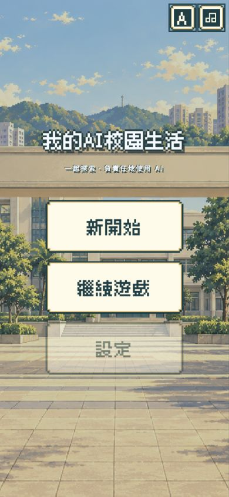

The school illustration, centered title and large cream buttons form a clear entry. Language and audio controls remain visible at the top. Continue is a distinct action; the disabled Settings control visibly has lower emphasis. The screenshot does not establish a first-visit state or prove that a particular saved game exists. The disabled Settings option remains a discoverability limitation: users must enter the game to reach the main settings panel.

### 2. Choose Student or Teacher — clear branching at 390 pixels

**Evidence:** `06-role-entry-390.png`, 390 × 844.

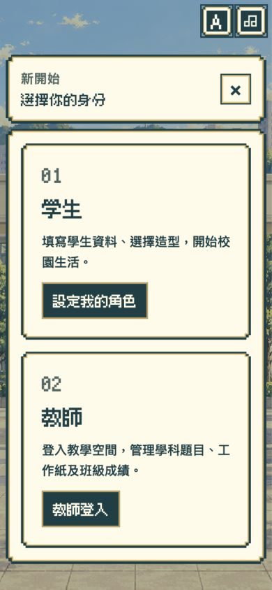

Both choices and their actions fit within the captured panel, with clear descriptions of the two roles. Teacher entry does not require an avatar or an active campus engine. Existing progression tests verify that opening this branch preserves a saved student game; choosing a new Student starts the replacement flow. The screenshot alone cannot prove that preservation, so it is a tested behavior rather than a visual finding.

### 3. Set up a student appearance — desktop and phone repairs verified in the captured states

**After-evidence:** `09-avatar-desktop-1440.png` (1440 × 800), `10-avatar-desktop-1280x600.png` and `11-avatar-controls-scrolled.png` (both 1280 × 600), plus `12-avatar-mobile-390.png` (390 × 844).

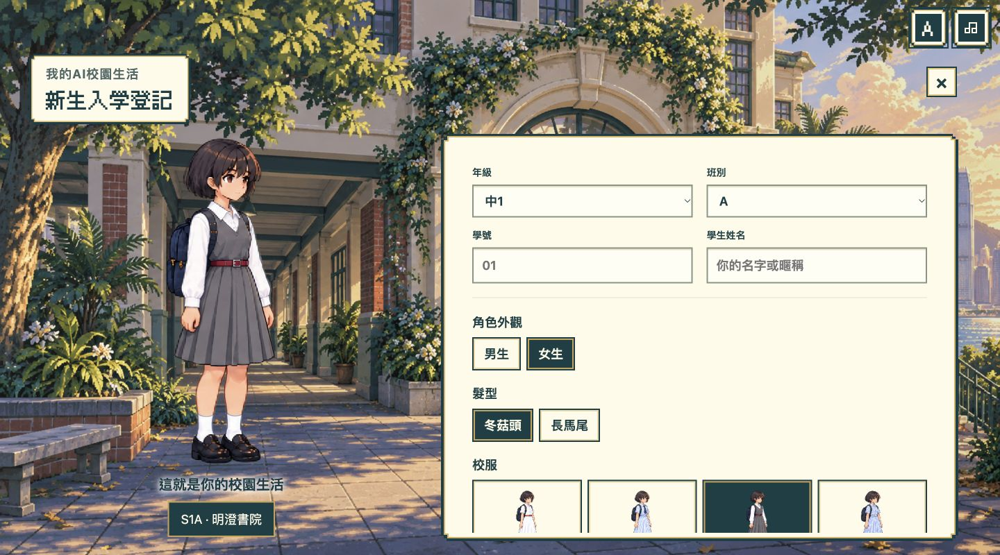
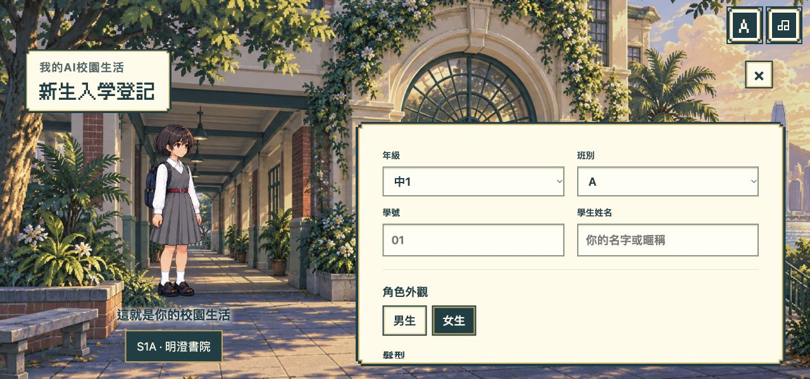
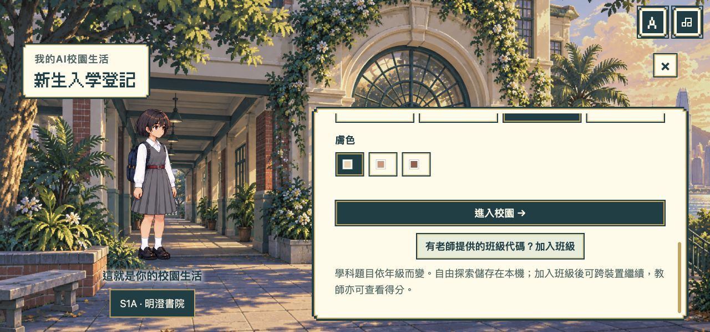
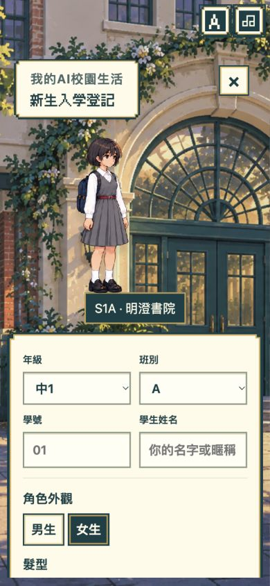

The original report showed a missing school background, a head clipped above the panel and form controls constrained by height. The repair in `campus-pixel-ui.css` explicitly restores the avatar background, removes the competing full-height/minimum-height demands, reduces the title framing and gives the form one usable scrolling area. The character fits the available preview with its aspect ratio preserved. Splitting the generic frame selectors also prevents their specificity from overriding the avatar layout.

In capture 09, the background is visible across the desktop view, the student's complete figure is visible, and the top fields, gender, hairstyle and outfit choices appear in the form. The form continues below the fold rather than compressing every control into the available height. The clean 1280 × 600 capture 10 confirms the same complete figure and restored background in the short, unscrolled desktop state. Capture 11 shows its scrolled lower area: skin choices, Enter campus and the class-join action are reachable, with the complete figure still visible. The clean phone retake 12 shows the complete figure and school courtyard above a stacked form with grade, class, number, name and gender controls; later options continue below the visible area. These captures verify those states, not every outfit, language, zoom level or device.

A separate geometry check evaluated **all 16 gender × outfit × hairstyle idle combinations** at the real **480 × 720 preview-canvas size**. Drawn bounds had top ≥ 6 px, bottom ≤ 717 px, left ≥ 72 px and right ≤ 375 px. No head was clipped by the registered source-frame drawing in this check; skin variants share the same geometry. This supports a CSS/layout diagnosis rather than an atlas-crop diagnosis, but it is not a browser reproduction of the user's exact desktop state.

**Remaining checks:** exercise the longest English labels, increased text size, lower phone form actions and all appearance selections without losing form values. A still screenshot of the upper phone form does not establish the complete scrolling/focus journey.

### 4. Read the welcome dialogue — portrait and Skip placement verified at three sizes

**Evidence:** `03-dialogue-390-zh.png` (390 × 844), `04-dialogue-320-en.png` (320 × 568), and `05-dialogue-452-zh.png` (452 × 719).

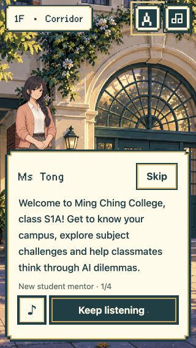
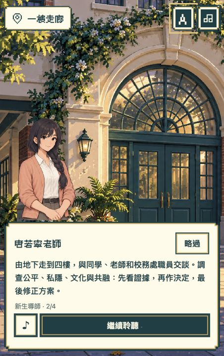

These captures show the current mobile placement repair: the mentor's full head remains visible above the text frame, Skip/略過 occupies a separate top-right area, and replay and next-line actions fit below the text. The English 320-pixel capture is the narrowest and shortest checked state; the welcome sentence wraps without colliding with the actions. The lead agent exercised these three viewport sizes during this run. This establishes the captured portrait/Skip layouts, not every line, locale, device orientation or browser zoom level.

The same mentor identity, 唐若寧老師 / Ms Tong, is recognizable across the captures. The framing is an ordinary new-student welcome, and the progress indicator distinguishes successive dialogue lines. Audio quality, pronunciation and voice availability cannot be judged from still images.

### 5. Open settings — readable hierarchy; longer content requires scrolling

**Evidence:** `02-settings-390.png`, 390 × 844.

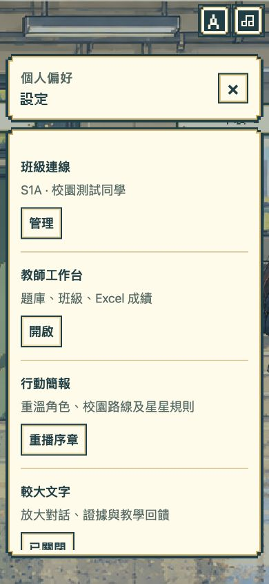

Class connection, teacher tools, introduction replay and larger text are separated with labels and dividers. The lower setting extends below the captured content viewport, making the scrollable area important. This is not evidence that the lower control is inaccessible; it requires a scroll/focus test through the complete panel. The captured name is a fictional QA identity. Keyboard traversal, error announcements and text-size persistence remain behavioral checks rather than screenshot conclusions.

### 6. Enter the teacher workspace — clear PIN action, duplicated framing

**Evidence:** `07-teacher-390.png`, 390 × 844.

The PIN label, input and unlock action are clearly visible. The outer game panel and inner teacher component each supply a title and close button. This duplicated header is a **P3 polish issue**: it consumes scarce vertical space and offers two visually competing exits. Consolidation can wait for a scoped design pass; it is not part of the current scroll repair.

**Historical retained Sites flow:** at the time of this screenshot, production access required the trusted allowlisted identity **and** the server PIN; knowing the PIN alone was insufficient. The independent Cloudflare deployment now uses an administrator-issued teacher login code instead. The [distribution audit](DISTRIBUTION-AUDIT.md) separates those release checks. This historical image does not verify the current public teacher sign-in or authorize anyone depicted by a screenshot.

### 7. Choose a subject and open its tools — repaired scrolling and clean phone entry verified

**Evidence of the original problem:** `08-teacher-hub-390.png`, 390 × 844.

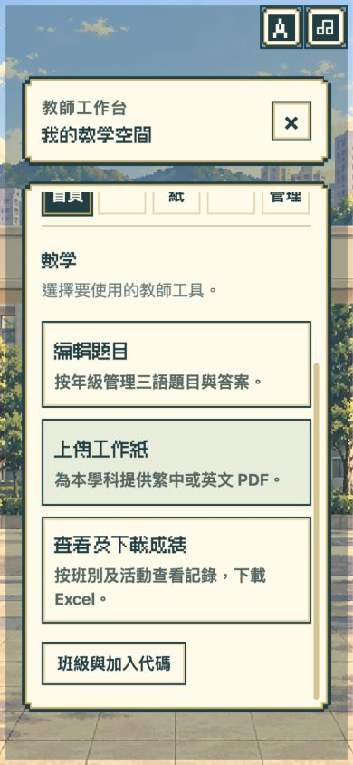

After selecting Mathematics from lower down the subject chooser, the parent `#modal-content` retained its earlier `scrollTop`. The destination therefore appeared midway through its content: the teacher heading/current-subject area was above the viewport and tab labels were clipped at the top. The Mathematics action cards themselves were clear, but the missing destination header weakened orientation.

The repair in `teacher-ui.js` resets the enclosing modal's scroll after view navigation finishes, or the component's own scroll when mounted independently. It focuses the new heading with `preventScroll`. Subject/tool navigation, class-results entry and editor/confirmation transitions use that reset; same-tab refresh, grade filters and error rerenders do not. Existing worksheet upload-failure form preservation was left unchanged.

`tests/campus-teacher.test.cjs` checks parent/standalone scrolling, post-render navigation, subject changes, retained grade scope and no focus/scroll reset on filtering or errors. Teacher, worksheet and progression tests pass. The original image above remains before-evidence.

**After-evidence:** `13-teacher-hub-390-after.png`, 390 × 844.

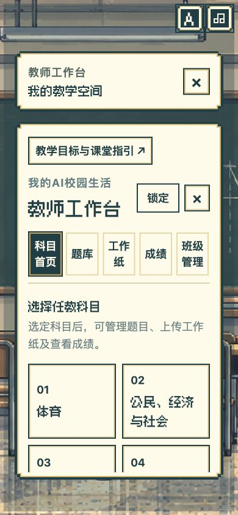

The clean retake shows the teacher heading, all five navigation tabs, subject-selection introduction and first subject cards after PIN login. The lead agent measured `#modal-content.scrollTop` as zero at this entry. The replacement capture requirement is satisfied for this state; further subject/tool transitions are covered by component tests rather than this still image. The duplicated outer/inner framing remains the separate P3 finding in Step 6.

### 8. Read the phone floor plan — all five floors and room choices remain visible

**After-evidence:** `15-map-mobile-390-cn.png`, `16-map-mobile-320-en.png` and `17-map-mobile-452-zh.png`, inspected at widths of 390, 320 and 452 pixels respectively.

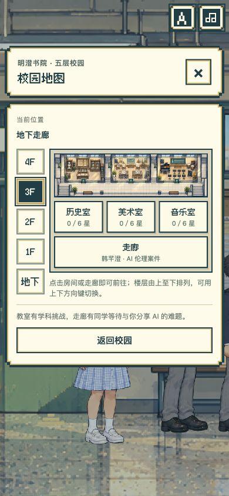
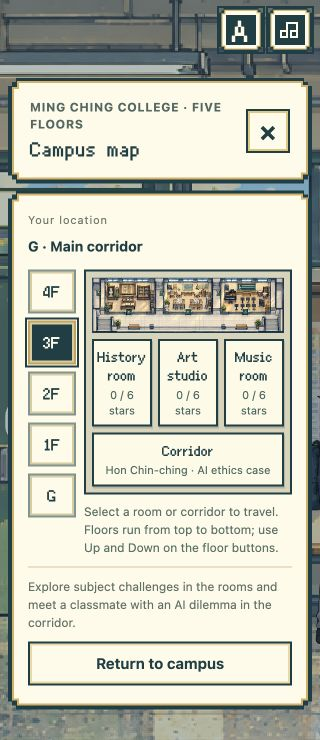
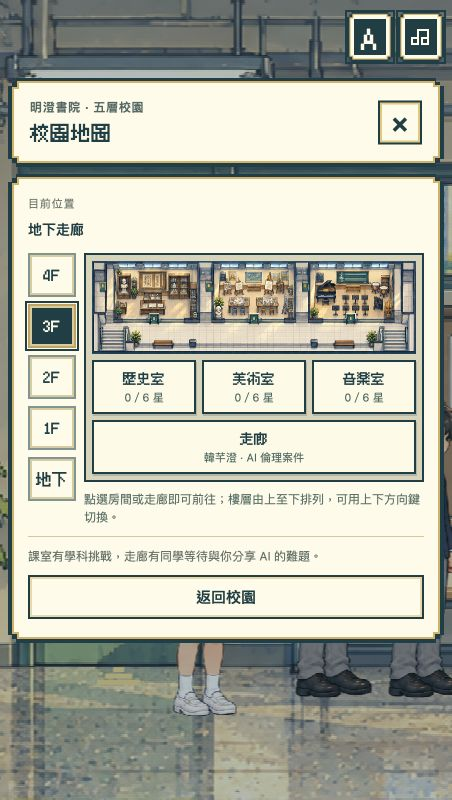

The phone layout retains the approved cream, teal and gold pixel style. Five floor buttons run from 4F down to G at the left; the complete floor-plan illustration fits beside them, and room labels sit below the illustration. The lead agent checked 44-pixel floor controls, no horizontal overflow at these widths and navigation by selecting a room. The 320-pixel English capture wraps longer room labels without clipping the floor selector or Return to campus action. The current-location text remains separate from the selected map floor. These captures do not establish every room name, enlarged-text setting, landscape height or assistive-technology route.

## Art, story and campus continuity

The inspected screenshots consistently use the selected cream, deep-teal and gold pixel frames, with school scenery behind the in-game panels. The dialogue portraits are opaque, retain readable faces and do not cover the dialogue body at the three inspected widths. Still images cannot establish walking quality, scale consistency in all 18 rooms, absence of alpha-edge artifacts in every atlas, or responsive behavior during animation.

A source continuity repair now aligns all four case names and meeting places with the shared character registry: 程曉嵐 / Ching Hiu-laam at G, 許晉言 / Hui Chun-yin at 1F, 沈樂葵 / Shum Lok-kwai at 2F, and 韓芊澄 / Hon Chin-ching at 3F. Meetings take place in the corresponding corridors; the library exhibition remains the translation scenario's background. The opening mentor and staff fallback names have also been aligned. Content tests check the names, scene prose, floors and singular pronouns. Assessment options, repairs, learning goals, identifiers and transfer content were preserved. Post-change screenshots of the four case bodies are still a follow-up visual check.

**Purposeful NPC routines are implemented in source, with incomplete artwork and live visual QA.** The [routine record](NPC-BEHAVIOR-PLAN.md) assigns duties, stations, partners, 20–60-second dwell and interruption recovery to all 20 canonical characters. Seven released sheets provide 96 activity drawings for 24 identity/outfit variants: 16 staff and four peers in uniforms 0 and 3. The eight peer variants in uniforms 1–2 retain neutral fallback for missing activities. There are now five ambient pupils per corridor and three per room; their faceless activity proposal awaits confirmation. This audit has no completed scene-level motion capture and does not describe every reading, writing or paired exchange as visually delivered. Keep interaction pauses, one identity per named character, bounded movement, doorway access and genuine pose support in the acceptance checks.

**Current audio experience:** the user retained existing device Cantonese and removed the teacher Speech Studio. The source now bundles 104 exact fixed NPC/introduction MP3s, with 52 Mandarin and 52 English lines for 20 characters; academic questions, options and explanations are text-only so teacher edits need no audio refresh. Four reused voices have catalog locale/gender verification, and every MP3 passed full decoding and SHA-256 checks. This is technical review, not a full listening claim. The lead agent observed local recordings complete for Mandarin male/female and English male/female examples, including male Mandarin on the Mac lacking a matching device voice. Empty device-voice inventory now waits up to three seconds before reporting unavailable. Academic speech API paths reject quote/generate/lookup/approval/playback with HTTP 410; integration mocks verify spoken NPC greetings followed by silent academic content. OpenRouter Cantonese failed user listening and remains blocked. Cantonese voice availability and complete target-device gameplay listening remain relevant checks.

A further fixed-audio regression came from grade hydration overwriting a room's original greeting description. Removing that overwrite preserves the fixed greeting while questions still change by grade. The actual-app integration test now exercises grades 1–6 in Mandarin and English, free/class loading, teacher-question refresh and all 27 dialogue branches. It reaches all 104 released character/locale/text matches and rejects the previous metadata-mutation regression. This verifies runtime corpus reachability with mocked audio, separately from the browser playback checks and physical listening.

**Actual-game Mandarin evidence:** [playback status record](../tests/qa-artifacts/mobile-audit/18-mandarin-male-game.json) accompanying the mathematics teacher's fixed greeting:

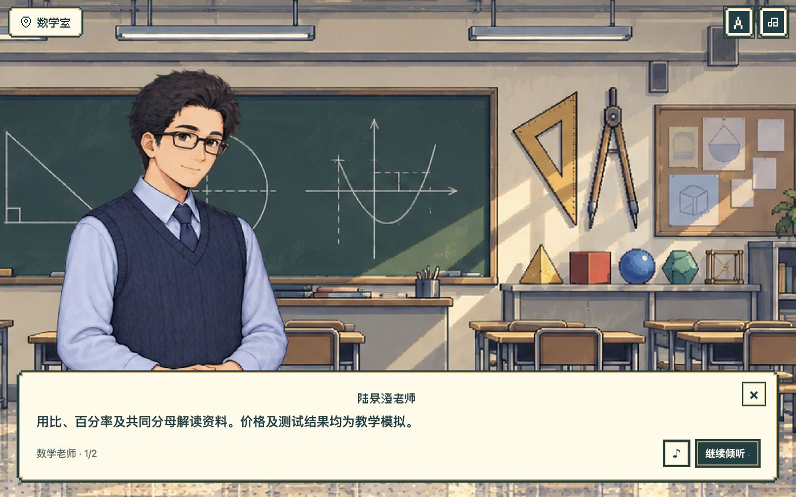

The record reports `source: recorded`, `locale: zh-CN`, `gender: male`, `event: end`, `status: ready` and an empty error. It verifies completion of the actual app's fixed Mandarin line through the recorded-audio route, including the hydrated-room fix. The image and event record do not establish physical audibility or independently certify pronunciation.

## Prioritized status and accessibility limits

| Finding | Priority | Status at this checkpoint |
|---|---|---|
| Desktop enrolment background/figure/form clipping | P2 | Repaired source; captures 09–12 verify normal/short desktop and phone background/full figure, plus reachable desktop lower controls; full phone scrolling/focus journey remains |
| Teacher subject hub inherits previous scroll position | P2 | Source/regression tests fixed; capture 13 verifies top-of-panel heading, tabs and subject introduction after PIN login at 390 pixels |
| Mobile dialogue portrait/Skip/text overlap | P2 | Captured repaired layout inspected at 390, 320 and 452 pixels; broad-device testing remains |
| Phone map floor selector and room layout | P2 | Captures 15–17 show five floors and complete plan at 320/390/452 pixels; lead agent checked no horizontal overflow and room navigation |
| Old case names/meeting locations conflict with current cast | P2 | Three-language source correction and content tests passed; case-body visual retake remains |
| Teacher page repeats header and close affordance | P3 | Visible in Step 6; deferred |
| Generic wandering instead of purposeful campus routines | UX improvement | Behavior implemented and simulated; 7 sheets/96 drawings released; uniforms 1–2 and ambient art plus scene-level motion QA pending |
| Speech scope and maintenance | Revised user direction | Teacher Speech Studio removed; academic content text-only; 104 exact Mandarin/English MP3s integrated with catalog/decode/integrity checks; existing device Cantonese retained; full listening review remains |

Keyboard controls, live feedback, reduced-motion handling and focus styles exist in the source, but screenshots do not demonstrate complete accessibility. Test the complete route with VoiceOver and a Windows screen reader; verify canvas NPC discovery, logical reading/focus order, Escape and focus return, enlarged text, contrast across real backgrounds, touch targets, landscape/short-height reflow and motion preferences. Text remains essential when browser speech is unavailable; audible voice/gender/locale checks remain device-specific.

No classroom pilot, measured lesson timing, learning-efficacy study or full accessibility-conformance assessment was conducted for this report. The captured steps do not cover every question, every error state, teacher uploads, historic scores, cross-device recovery, native printing or installed-browser windows. Use the supporting quality/distribution reports for their narrower tested scopes. This documentation task did not publish, synchronize GitHub, alter runtime code or claim that concurrent repairs are already on the public site.
